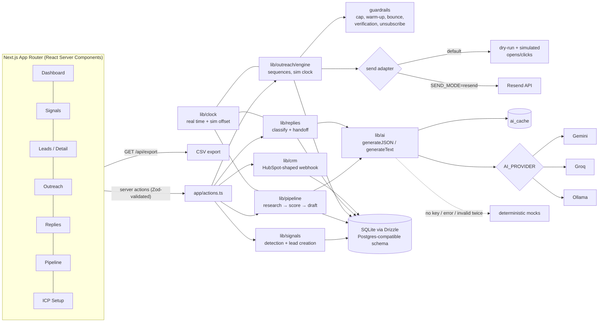

# Signalflow

**An AI-powered outbound CRM that turns buying signals into qualified, replied-to leads.**

Signalflow detects a buying signal about a company (hiring, funding, expansion, a launch, a new exec, an RFP), researches the company with AI, scores it against your Ideal Customer Profile, drafts a personalized 3-step email sequence, sends it inside deliverability guardrails, classifies replies, and hands interested leads to sales.

It runs end to end on seed data with **no paid APIs and no real email sending**. Add a free Gemini or Groq key, or run Ollama, and the same flow uses a real model.

---

## Quick start

```bash
npm install
npm run dev        # http://localhost:3000
```

That's it. On first start the app creates `data/signalflow.db`, runs the migrations and seeds it: 48 companies, 100 signals, 39 leads at every stage, plus emails, replies and 14 days of activity.

| Command | What it does |
|---|---|
| `npm run dev` | Start the app (auto-migrates and auto-seeds an empty DB) |
| `npm run seed` | Reset the database to the demo seed (ids restart at 1) |
| `npm test` | AI-adapter tests plus an end-to-end smoke test on a throwaway DB |
| `npm run typecheck` / `npm run lint` | Strict TypeScript / ESLint |
| `npm run build && npm start` | Production build |

Requires Node 20+ (tested on Node 24, Windows 11).

## Switching AI providers

Copy `.env.example` to `.env.local` and pick a provider. Restart `npm run dev` after any change.

| Provider | Set | Notes |
|---|---|---|
| **Mock** (default with no keys) | nothing, or `AI_PROVIDER=mock` | Deterministic outputs built from the real inputs. Mock scoring really evaluates the ICP, so editing the ICP still changes scores offline. |
| **Gemini** | `AI_PROVIDER=gemini`, `GEMINI_API_KEY=…` | Free tier key from Google AI Studio. Default model `gemini-3.5-flash-lite`. |
| **Groq** | `AI_PROVIDER=groq`, `GROQ_API_KEY=…` | Free tier. Default model `llama-3.3-70b-versatile`. |
| **Ollama** | `AI_PROVIDER=ollama`, optional `OLLAMA_URL` | Local, fully offline. `ollama pull llama3.1` first. |

The sidebar footer shows the active provider. Every AI toast says whether the result was live, cached, or a mock fallback.

> Free tiers rate-limit. "Re-score all leads" makes one call per lead; anything rejected falls back to mock for that lead, and successful results are cached, so the next run is instant.

## Architecture



### The AI adapter (`lib/ai`)

```ts
generateJSON<T>(prompt: string, schema: ZodType<T>, opts?: { task?, mock? }): Promise<T>
generateText(prompt: string, opts?): Promise<string>
```

1. Resolves the provider from `AI_PROVIDER` and reads keys from the environment.
2. Looks up `ai_cache` by `sha256(provider | model | mode | prompt)`. A hit is returned without an API call.
3. Calls the provider in **JSON mode** (Gemini `responseMimeType`, Groq `response_format`, Ollama `format: "json"`).
4. Extracts JSON (tolerating code fences), then **validates with Zod**.
5. On a parse or validation failure, **retries once** with a corrective prompt that quotes the bad output and the exact Zod issues.
6. If there's no provider, the HTTP call fails, or both attempts are invalid, it returns `opts.mock()`. **The demo never breaks.**
7. Logs every call (`ai_calls`) for the cost panel.

`scripts/ai-test.ts` covers the retry, cache and fallback paths against a stubbed `fetch`.

### Pipeline rules

- **Research** returns `{summary, industry, scale, likely_needs[], recent_moves[], why_now}`.
- **Score** returns `{score, reasons[{criterion, points, explanation}], disqualified}`. The ICP is injected into the prompt, using a fixed rubric (industry 25, title 20, size 20, geography 10, signal type 15, recency 10). Disqualified leads are capped at 10 and never drafted.
- **Draft** writes all 3 steps. The Zod schema itself rejects bodies over 120 words, which triggers the corrective retry. The prompt requires a reference to the signal, one low-friction CTA, and no invented claims.
- **Classify** returns `{classification, snooze_until?, reason}`. Snooze dates are re-checked in code, so "try me in Q2" always becomes a *future* April 1 and a `snoozed` lead, never `closed_lost`.

### Sequences and the simulated clock

All time reads go through `lib/clock.now()`, which is real time plus `workspace_settings.sim_offset_days`. The **+1d / +3d / +7d** buttons in the top bar advance it, then:

- due emails are sent (step 1 on approval, step 2 at +3 days, step 3 at +7 days)
- snoozes whose date has passed wake up (the lead returns to `scored`)
- the warm-up cap grows

Any reply cancels the remaining steps. An out-of-office reply *pauses* them until the return date instead.

### Deliverability guardrails

Checked on **every** send. A blocked send stays queued and shows the reason in the UI:

| Rule | Behaviour |
|---|---|
| Daily send cap | Configurable; sends past it wait for tomorrow |
| Warm-up ramp | 10/day on day 1, +5/day, up to the cap |
| Email verification | Unverified addresses are blocked (mock verifier on the lead page / approval card) |
| Bounce-rate meter | All sending pauses above 5% |
| Dedicated subdomain | Sending from a root domain (e.g. `routewise.example`) is blocked |
| Unsubscribe check | Any unsubscribe reply suppresses the lead permanently |

## Demo script (5 minutes)

1. **Dashboard (30s).** KPI tiles, the funnel with stage-to-stage conversion, 14 days of sends and replies, the live activity feed, and the AI cost panel (estimated calls and cost per interested lead).
2. **Signals (45s).** Filter by type or industry. Click **Run detection** and new signals appear with a live dot. Click **Create lead** on one: a company, contact and lead are created and you land on the lead page.
3. **Lead detail (75s).** Click **Verify email**, then **Run all**. Watch the toasts for research, then score, then draft. Walk through the research brief (why-now angle) and the **score breakdown**: every point is explained against the ICP.
4. **ICP Setup (45s).** Add `SaaS` to Target industries, click **Save**, then **Re-score all leads**. The toast reports how many scores changed. Open a SaaS lead to show the higher industry-fit points. (Remove it again afterwards.)
5. **Outreach (60s).** Point at the guardrail cards (cap, warm-up ramp, bounce meter, subdomain). Edit a draft, then **Approve sequence**: step 1 sends (dry-run). Show a blocked send with its reason (an unverified lead). Turn on **Auto-approve ≥ 80**. Click **+3d** in the top bar: step 2 goes out and opens and clicks appear.
6. **Replies (45s).** Pick a contacted lead and the **Not now** preset, then **Simulate reply**. It's classified as `not_now`, **snoozed until April 1**, and the remaining steps are cancelled. Then send **Interested**: the lead moves to **Handoff** with a one-line summary and a suggested next step. Click **Push to CRM**.
7. **Pipeline (20s).** Drag a card to *Closed*. The toast confirms and the move appears on the lead's timeline.
8. **Export (10s).** **Export outcomes** on the dashboard, or **CSV** on Leads.

Reset anytime with `npm run seed`, then hit **Reset** in the top bar if you advanced the clock.

## What I mocked vs what is real

| Area | Real | Mocked / simulated |
|---|---|---|
| AI | Provider adapters for Gemini, Groq and Ollama with JSON mode, Zod validation, corrective retry, hashing cache and call logging | Deterministic mock outputs when no provider is set or a call fails |
| Data | SQLite and Drizzle, migrations, a Postgres-compatible schema, an activity log on every action | All companies, people and signals are fictional (`.example` domains) |
| Signals | Detection engine, optional live RSS source (`SIGNAL_RSS_URL`) | Default detection draws from an industry-aware template pool |
| Sending | Sequence engine, scheduling, guardrails, Resend adapter (`SEND_MODE=resend`) | Dry-run by default: emails are marked sent, opens, clicks and ~3% bounces are simulated deterministically |
| Email verification | Guardrail enforcement | Verifier is a format check plus a deterministic pseudo-random result |
| Time | The engine runs on a clock abstraction | "Simulate time passing" advances a stored offset |
| Replies | AI classification, snooze date computation, handoff summary | Replies come from the "Simulate reply" panel, not an inbox |
| CRM | Real `POST` of HubSpot-shaped JSON (contact, company, deal and associations) to your webhook | With no webhook URL, the payload is built and logged but not sent |
| Cost | Live call counts and token-based cost from real usage | Pipeline estimate assumes ~700 input / 250 output tokens per call at Gemini 2.5 Flash list price |
| Auth | None | Single demo workspace |

## Project layout

```
app/                 pages (Server Components) and app/actions.ts (all mutations, Zod-validated)
  api/export/        CSV export route
components/          sidebar, clock bar, badges, action button, reply simulator, shadcn/ui
lib/ai/              provider adapters, generateJSON/generateText, cache
lib/pipeline/        prompts, research/score/draft, deterministic mocks
lib/outreach/        sequence engine, guardrails, send adapters
lib/db/              Drizzle schema, client (auto-migrate and seed), seed data
drizzle/             SQL migrations
scripts/             seed, smoke test, AI adapter test
```
